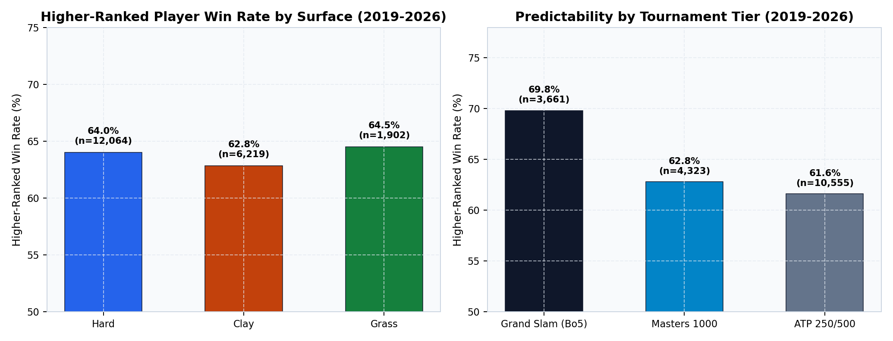
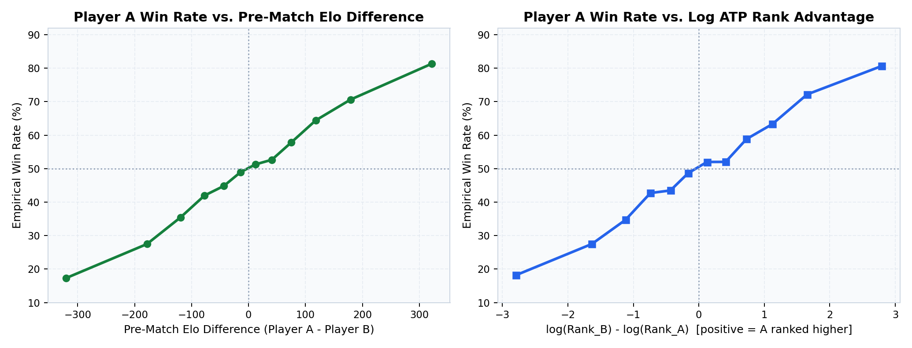
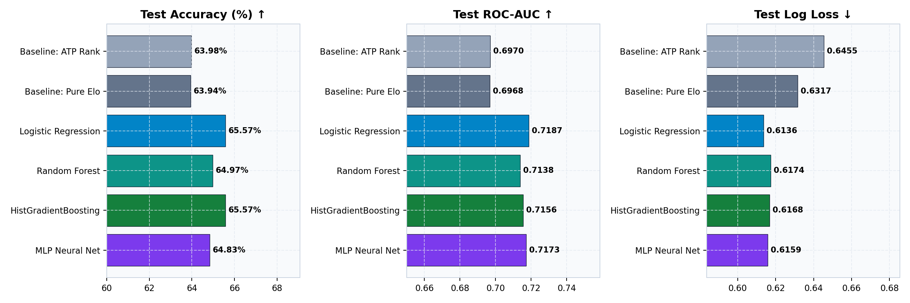
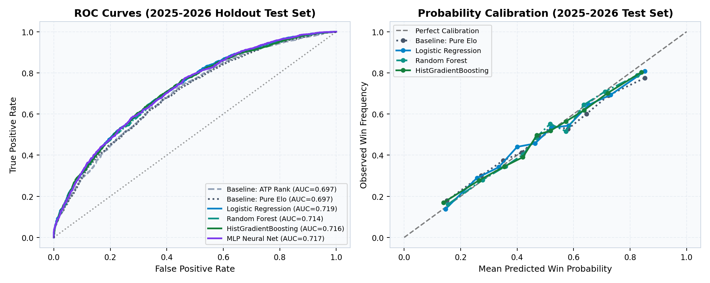
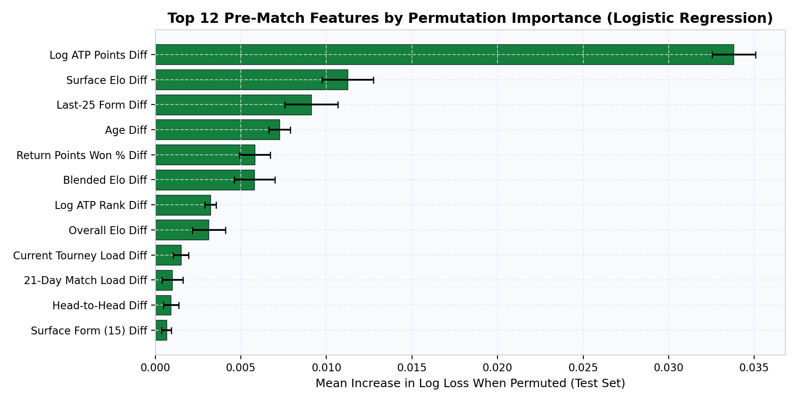
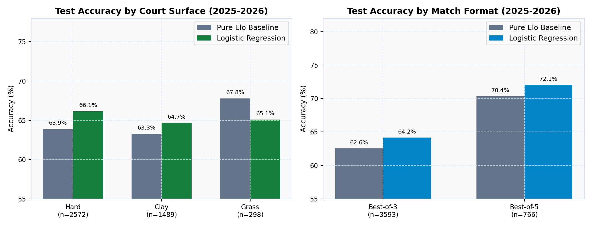

# Predicting Tennis Match Outcomes Using Machine Learning

[](https://popi689.github.io/Predicting-Tennis-Match-Outcomes-Using-Machine-Learning/)


> **Live Blog Site:** Open [`index.html`](index.html) or visit `https://popi689.github.io/Predicting-Tennis-Match-Outcomes-Using-Machine-Learning/` once GitHub Pages is enabled on `main` (`/`).

---

## Team Members

| Name | Role | GitHub / Contact |
| :--- | :--- | :--- |
| Member 1 *(Update Name)* | Data Pipeline & Feature Engineering | [@Popi689](https://github.com/Popi689) |
| Member 2 *(Update Name)* | Modeling, Evaluation & Blog Site | *Update email / handle* |

---

## Abstract

We build and evaluate a **strictly leakage-free machine learning pipeline** for predicting ATP Tour men's singles match outcomes across **23,110 played matches (2018–2026)** without using betting odds. Using **2018** as an Elo and rolling-history burn-in, **2019–2023** (`12,814` matches) for training, **2024** (`3,054` matches) for hyperparameter selection, and **2025–2026** (`4,359` matches) as an untouched holdout test set, an L2-regularized **Logistic Regression** trained on symmetric pre-match features achieves **65.57% test accuracy**, **0.7187 ROC-AUC**, and **0.6136 Log Loss**—outperforming both an ATP Ranking baseline (**63.98%**, Log Loss **0.6455**) and a Pure Elo rating baseline (**63.94%**, Log Loss **0.6317**), and reaching **72.06% accuracy** in Best-of-5 Grand Slam matches.

---

## Table of Contents

1. [I. Introduction](#i-introduction)
2. [II. Dataset & Exploratory Data Analysis](#ii-dataset--exploratory-data-analysis)
3. [III. Methodology & Feature Engineering](#iii-methodology--feature-engineering)
4. [IV. Model Evaluation & Analysis](#iv-model-evaluation--analysis)
5. [V. 2025–2026 Grand Slam Final Case Studies](#v-20252026-grand-slam-final-case-studies)
6. [VI. Repository Structure & Quick Start](#vi-repository-structure--quick-start)

---

## I. Introduction

Tennis match outcome modeling is a classic sports analytics benchmark with zero draws and rich match-level telemetry, yet naive pipelines often suffer from two forms of data leakage:
1. **Temporal leakage** from random train/test splits across seasons.
2. **Post-match leakage** from feeding box-score statistics of the target match itself.

This project investigates three core questions:
- **RQ1:** How much predictive gain do dynamic overall + surface-specific Elo ratings and rolling serve/return metrics provide over official ATP rankings alone?
- **RQ2:** Do non-linear tree ensembles (`RandomForestClassifier`, `HistGradientBoostingClassifier`) or neural networks (`MLPClassifier`) outperform calibrated linear models (`LogisticRegression`) on pairwise tennis differentials?
- **RQ3:** How do court surface (Hard, Clay, Grass) and match format (Best-of-3 vs. Best-of-5) affect upset rates and model accuracy?

---

## II. Dataset & Exploratory Data Analysis

- **Source:** Archival ATP Tour singles match CSVs (`2018–2026`) following Jeff Sackmann's standard `tennis_atp` schema.
- **Cleaning:** From **23,270** raw records, **160** unplayed walkovers/defaults (`W/O`, `DEF`) were removed, leaving **23,110 played matches** across **1,080 unique players**.
- **Chronological Ordering:** Matches are sorted by `(tourney_date, tourney_id, round_order, match_num)` so every player state is updated strictly *after* each match finishes.

### Key EDA Patterns (2019–2026)

| Segment | Played Matches (with rank) | Higher-Ranked Win Rate |
| :--- | :---: | :---: |
| **Hard** | 12,064 | 64.03% |
| **Clay** | 6,219 | 62.82% |
| **Grass** | 1,902 | 64.51% |
| **Grand Slam (Best-of-5)** | 3,661 | 69.82% |
| **Masters 1000** | 4,323 | 62.80% |
| **ATP 250 / 500** | 10,555 | 61.61% |





---

## III. Methodology & Feature Engineering

### Symmetrized Pairwise Representation
For every match, the actual winner is assigned to **Player A** (`target = 1`) or **Player B** (`target = 0`) with 50/50 probability (`seed=42`), preventing any column-order leakage. All numeric features are expressed as `Feature(A) - Feature(B)`.

### 28 Strictly Pre-Match Features
- **Ratings & Rankings:** Overall Elo (`K=36` Grand Slam / `32` Masters / `28` Tour), Surface Elo (`K=30`), Blended Elo (`0.6*Overall + 0.4*Surface`), pre-tournament `log(Rank)` diff, and `log1p(ATP Points)` diff.
- **Rolling Form & Rivalry:** Laplace-smoothed win rates over last `10` and `25` matches, last `15` matches on the same surface, career win rate, log match experience, and prior Head-to-Head diff.
- **Serve & Return Telemetry (last 15 matches):** Ace rate, double-fault rate, 1st-serve %, 1st-serve won %, 2nd-serve won %, break-points saved %, and return-points won %.
- **Workload & Context:** Matches played so far in the current tournament, 21-day match count, age diff, height diff, left-handed flag, surface flags, Best-of-5 flag, Grand Slam / Masters flags.

### Temporal Split
| Split | Seasons | Matches | Role |
| :--- | :---: | :---: | :--- |
| **Warm-up** | 2018 | 2,883 | Elo & rolling stats initialization only |
| **Train** | 2019–2023 | 12,814 | Model training & preprocessing |
| **Validation** | 2024 | 3,054 | Hyperparameter tuning (log loss) |
| **Holdout Test** | 2025–2026 | 4,359 | Final untouched evaluation |

---

## IV. Model Evaluation & Analysis

### Holdout Test Results (2025–2026, `n = 4,359`)

| Model | Configuration | Accuracy ↑ | ROC-AUC ↑ | Log Loss ↓ | Brier Score ↓ |
| :--- | :--- | :---: | :---: | :---: | :---: |
| **Logistic Regression** | **Linear (`C=0.01`)** | **65.57%** | **0.7187** | **0.6136** | **0.2134** |
| **HistGradientBoosting** | Gradient Boosting (`depth=3`) | **65.57%** | 0.7156 | 0.6168 | 0.2145 |
| **MLP Neural Net** | Neural Network (`64-32`) | 64.83% | 0.7173 | 0.6159 | 0.2143 |
| **Random Forest** | Bagged Trees (`depth=8`) | 64.97% | 0.7138 | 0.6174 | 0.2149 |
| **Baseline: Pure Elo** | Rating Baseline | 63.94% | 0.6968 | 0.6317 | 0.2209 |
| **Baseline: ATP Rank** | Heuristic Baseline | 63.98% | 0.6970 | 0.6455 | 0.2249 |





### Feature Importance & Surface Breakdown

- **Top Predictive Signals (Test Permutation Importance):** `Log ATP Points Diff` (`0.03380`), `Surface Elo Diff` (`0.01124`), `Last-25 Form Diff` (`0.00912`), `Age Diff` (`0.00726`), and `Return Points Won % Diff` (`0.00581`).
- **By Surface (2025–2026 Test):** Logistic Regression beats Pure Elo on **Hard** (`66.14%` vs `63.88%`, `n=2,572`) and **Clay** (`64.67%` vs `63.26%`, `n=1,489`), while **Grass** (`n=298`) shows higher short-season variance (`65.10%` vs `67.79%`).
- **By Format (2025–2026 Test):** **Best-of-5** reaches **72.06%** accuracy (`n=766`) versus **64.18%** in **Best-of-3** (`n=3,593`).





---

## V. 2025–2026 Grand Slam Final Case Studies

| Tournament | Surface | Actual Result | Score | Model Pick (Confidence) | Status |
| :--- | :---: | :--- | :--- | :--- | :---: |
| 2025 Australian Open | Hard | **Jannik Sinner (#1)** def. Alexander Zverev (#2) | `6-3 7-6(4) 6-3` | Jannik Sinner (69.66%) | Correct |
| 2025 Roland Garros | Clay | **Carlos Alcaraz (#2)** def. Jannik Sinner (#1) | `4-6 6-7(4) 6-4 7-6(3) 7-6(2)` | Carlos Alcaraz (50.02%) | Correct |
| 2025 Wimbledon | Grass | **Jannik Sinner (#1)** def. Carlos Alcaraz (#2) | `4-6 6-4 6-4 6-4` | Carlos Alcaraz (54.84%) | Missed |
| 2025 US Open | Hard | **Carlos Alcaraz (#2)** def. Jannik Sinner (#1) | `6-2 3-6 6-1 6-4` | Jannik Sinner (58.07%) | Missed |
| 2026 Australian Open | Hard | **Carlos Alcaraz (#1)** def. Novak Djokovic (#4) | `2-6 6-2 6-3 7-5` | Carlos Alcaraz (74.62%) | Correct |
| 2026 Roland Garros | Clay | **Alexander Zverev (#3)** def. Flavio Cobolli (#14) | `6-1 4-6 6-4 6-7(5) 6-1` | Alexander Zverev (78.88%) | Correct |

---

## VI. Repository Structure & Quick Start

```text
Predicting-Tennis-Match-Outcomes-Using-Machine-Learning/
├── index.html               # GitHub Pages blog site
├── README.md                # Project report & documentation
├── requirements.txt         # Python dependencies
├── assets/
│   ├── css/style.css        # Blog styling (light/dark theme, responsive layout)
│   ├── js/main.js           # Interactive split toggle, TOC scrollspy & lightbox
│   └── figures/             # Generated EDA & evaluation charts (PNG)
├── data/                    # ATP singles match CSVs (2018-2026)
├── results/
│   └── metrics.json         # Exported validation/test metrics & case studies
└── src/
    └── run_pipeline.py      # End-to-end leakage-free feature & ML pipeline
```

### Run Locally

```bash
pip install -r requirements.txt
python src/run_pipeline.py
```
